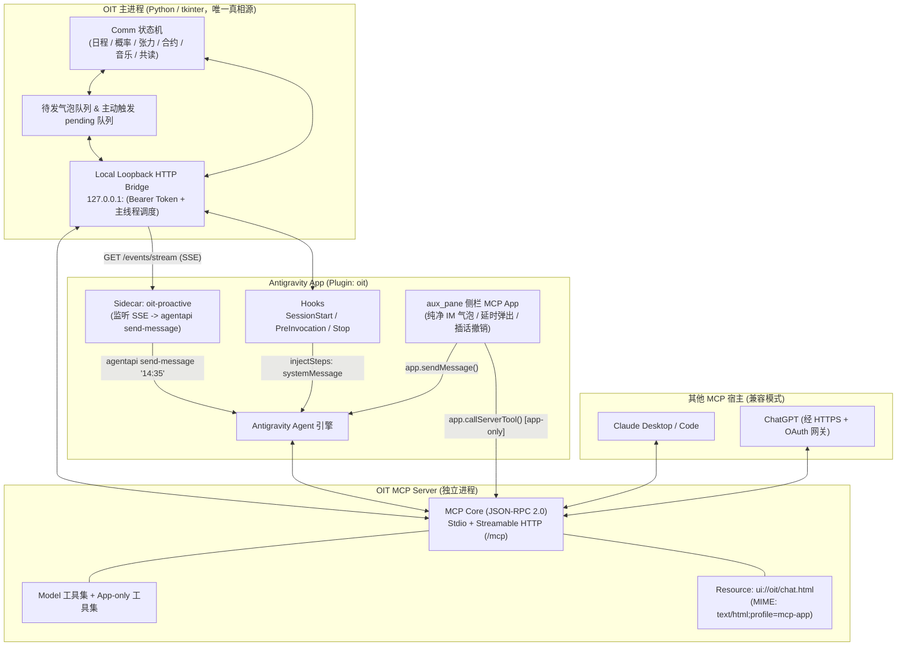

# OIT MCP Server 与跨宿主集成技术规格书（Spec）

> **用途**：本规格书面向后续负责开发的 AI / 工程师，定义将 OIT（Obliphur's Integrated Terminal）从不合规的本地 CLI 子进程调用（`ai_assist/ai_cli.py`）迁移为**标准 MCP Server + 客户端插件架构**的完整方案。
> **核心目标**：
> 1. **主阵地（Antigravity 桌面端）**：通过 **MCP Server + Sidecar + Hooks + `aux_pane` MCP App**，100% 合规实现**主动对话触发、隐藏系统信息、分条延时气泡与插话撤销**，OIT 仅做状态机与只读回显/手机同步。
> 2. **跨宿主兼容（Claude / ChatGPT）**：核心 MCP 协议严格遵循官方标准（`stdio` + `Streamable HTTP` + 标准 `ext-apps`），确保同一套 OIT MCP Server 可无缝接入 **Claude Desktop / Claude Code** 与 **ChatGPT Connectors**，非 Antigravity 宿主自动优雅降级。

---

## 1. 跨宿主兼容矩阵

| 能力维度 | Antigravity App（主阵地） | Claude Desktop / Web | Claude Code (CLI) | ChatGPT (Web / Connectors) |
| :--- | :--- | :--- | :--- | :--- |
| **MCP 传输层** | `stdio` 或 `Streamable HTTP` (`/mcp`) | `stdio`（桌面） / `Streamable HTTP`（远程） | `stdio` / `Streamable HTTP` | **仅远程 `Streamable HTTP` (`/mcp`)**（需 HTTPS 隧道/反代） |
| **认证方式** | 本地 Token / 环境变量 | 本地 Token / OAuth | 本地 Token / Bearer | **用户授权 OAuth 2.1**（`/.well-known/oauth-protected-resource`，不支持纯静态 API Key） |
| **核心业务工具** | 完整支持（18+ OIT 工具） | 完整支持 | 完整支持 | 完整支持（含 `annotations` / `outputSchema`） |
| **UI（MCP Apps `SEP-1865`）** | 完整支持（Inline + `aux_pane` 侧栏 + `app.sendMessage`） | 支持标准 `ext-apps`（忽略 `com.google.antigravity/ui` 私有字段） | 降级为 `content` 纯文本 | 降级为 `content` 纯文本（或按需适配 Apps） |
| **动态状态隐藏注入** | **`PreInvocation` Hook** 自动注入折叠 `systemMessage` | 降级：模型调 `oit_get_turn_context` 拉取 | 降级：`oit_get_turn_context`（或 Claude Hooks） | 降级：模型调 `oit_get_turn_context` 拉取 |
| **主动对话唤醒** | **Sidecar + `agentapi send-message`** 实时推送 | 不支持后台推送（打开后由 `oit_get_turn_context` 补拉待触发事件） | 不支持后台推送 | 不支持后台推送 |
| **分条延时 & 插话撤销** | **`aux_pane` MCP App 完整还原** | 若支持 `ext-apps` 完整渲染，否则退回单段文本 | 退回单段文本 | 退回单段文本 |

> [!IMPORTANT]
> **传输协议红线**：切勿实现已废弃的旧版 HTTP+SSE 传输（MCP 2024-11-05）。Antigravity、Claude、ChatGPT 现代远程连接均以 **Streamable HTTP（`/mcp`）** 为准；本地桌面优先 **Stdio**。

---

## 2. 总体架构



### 进程边界设计原则
1. **OIT 本体保持仅标准库**：OIT 主进程不强行引入重型异步 MCP 框架，只在进程内新增轻量级 `http.server` Loopback Bridge（参考现有 `coread_service.py` 的本地桥接与密钥鉴权模式），所有触碰 `Comm` / tkinter 状态的操作均安全切回主线程执行。
2. **MCP Server 采用 TypeScript / Node.js 独立进程**：使用官方 `@modelcontextprotocol/sdk`（TS）与前端 `@modelcontextprotocol/ext-apps` 统一工具链（可复用 OIT 在 `coread_service.py` 中已验证的 Node 运行时管理经验），负责 MCP 协议编解码、双传输（`stdio` / `Streamable HTTP`）及托管 `ui://oit/chat.html`，所有状态读写一律转发给 OIT Bridge。
3. **OIT 聊天页定位**：迁移后 OIT 桌面端沟通页退化为**只读回显与跨设备同步视图**，彻底移除 `ai_assist/ai_cli.py` 中调用外部订阅 CLI 的逻辑。

---

## 3. OIT 本地 Bridge 接口规格

### 3.1 启动与服务发现
- OIT 启动后在 `127.0.0.1` 随机可用端口启动 HTTP Bridge，并生成 32 字节随机十六进制 `token`。
- 写入本地发现文件：`<OIT_DATA_DIR>/mcp_bridge.json`（仅当前用户可读）：
  ```json
  {
    "port": 49152,
    "token": "<64-hex-secret>",
    "pid": 12345,
    "protocol": 1
  }
  ```
- 所有请求必须携带 `Authorization: Bearer <token>`，否则返回 `401`。

### 3.2 HTTP / SSE Endpoints

| 方法与路径 | 调用方 | 职责 |
| :--- | :--- | :--- |
| `GET /health` | MCP / Sidecar / Hooks | 健康检查，返回 OIT 版本、当前活跃 `persona_id`、是否处于硬屏蔽（`hard_block`） |
| `POST /session/bind` | `SessionStart` Hook / MCP | 绑定 `{"conversation_id", "persona_id", "host"}`（支持一人设一会话） |
| `GET /turn/context?conversation_id=...&consume_trigger=1` | `PreInvocation` Hook / `oit_get_turn_context` | 返回此刻精简动态状态（时间、对方日程段、张力、冷却、share data 增量、上轮未发完被撤销摘要）；不返回用户计时器、整点记录、日历或统计数据，这些数据只通过 share data 提供；若存在待消费的 `pending_trigger`，一并返回并原子清空 |
| `POST /tool/execute` | MCP Server | 执行业务工具（`name`, `arguments`, `conversation_id`）；`oit_answer_image` 在解答图片模式开启时接收子代理原始答案与风格化文本，生成待附加的 PNG |
| `POST /reply/submit` | MCP Server (`oit_reply`) | 接收回复（`bubbles` 或 `text`）及控制字段（`wait_minutes`/`cut_minutes`/`network_minutes`/`offenses`/`tension`/`valence` 等），写入待发队列 `ReplyBatch`；若之前成功调用 `oit_answer_image`，将图片附加到最后一条回复气泡，返回 `{batch_id, items: [{id, text, delay_ms}]}` |
| `GET /ui/state?persona_id=...&cursor=...` | `aux_pane` App（经 app-only 工具） | 返回增量聊天记录、当前待发队列、人设基础信息、张力/专注状态栏数据 |
| `POST /ui/delivered` | `aux_pane` App（经 app-only 工具） | 标记某气泡 `msg_id` 已真正弹出：正式写入 OIT 历史、触发音效提示、推送安卓同步 |
| `POST /ui/interrupt` | `aux_pane` App（经 app-only 工具） | 用户即将发新消息：立即作废当前 `ReplyBatch` 中尚未弹出的气泡，记录撤销条数供下一轮上下文使用 |
| `POST /ui/action` | `aux_pane` App（经 app-only 工具） | 执行聊天栏工具开关、底部审批横幅（接受/拒绝）、或拉起 OIT 原生硬件/弹窗（联合行动词条板、起点平移、MIDI 演奏评判、共读、OCR、选图） |
| `GET /ui/media?kind=avatar\|voice\|chat_image&id=...` | `aux_pane` App（经 app-only 工具） | 返回头像、语音或聊天图片的 `data:<mime>;base64,...`（规避 MCP App CSP 外链限制）；图片 id 仅按聊天图片目录中的 basename 读取 |
| `POST /turn/fallback_sync` | `Stop` Hook | 兜底同步：当模型未调 `oit_reply` 直接输出纯文本时，把提取出的纯文本记入 OIT |
| `GET /events/stream` | Sidecar（SSE） | 服务端事件推送：OIT 判定主动触发后推送 `{"event": "proactive", "persona_id", "conversation_id", "display_time": "14:35"}` |

---

## 4. MCP Server 接口规格

### 4.1 传输模式（TypeScript / Node.js，`@modelcontextprotocol/sdk`）
通过命令行参数切换，共用同一套工具与资源注册代码：
- `node server/dist/index.js --transport stdio`（默认，供 Antigravity / Claude Desktop / Claude Code 本地拉起）
- `node server/dist/index.js --transport http --host 127.0.0.1 --port 8765 --path /mcp`（Streamable HTTP，供本地调试或经反向代理 + OAuth 网关暴露给 ChatGPT / Claude 远程连接器）

### 4.2 Model 可见工具（复用 `defaults/comm_tools.json`）

除保留 [defaults/comm_tools.json](file:///e:/obliphur_terminal/defaults/comm_tools.json) 中全部 18 个现有工具外，做以下 **3 项增强**：

1. **增强 `oit_reply`（核心回复入口）**
   - 参数向下兼容现有字段，新增可选 `bubbles: string[]`（优先于 `text`；如果模型只传 `text`，服务端按 `<oit_message>` 或空行兜底拆条）。
   - 返回结果同时包含：
     - `content`：给模型与无 UI 客户端（Claude Code / ChatGPT）看的简洁文本确认；
     - `structuredContent`：给 MCP App 渲染用的 `{batch_id, persona, items: [{id, text, delay_ms}], actions}`。
   - 工具 `_meta`（兼容 Antigravity 与标准 `ext-apps`）：
     ```json
     {
       "ui": {
         "resourceUri": "ui://oit/chat.html"
       },
       "com.google.antigravity/ui": {
         "entrypoints": [
           { "type": "aux_pane", "title": "OIT Chat" }
         ]
       }
     }
     ```
2. **新增 `oit_get_turn_context`（跨宿主兼容必需）**
   - 供不支持 `PreInvocation` Hook 的宿主（Claude Desktop / ChatGPT）在每轮对话前拉取动态状态（时间、专注/休息、日程、张力、待处理主动触发事件）。
   - Antigravity 环境下由 `PreInvocation` Hook 自动注入，提示词告知模型若本轮已收到 `[OIT动态状态]` 则无需重复调用。
3. **补全 MCP `annotations` 与清理现有瑕疵**
   - 只读查询类工具（`oit_query`、`oit_music_catalog`、`oit_joint_offer`、`oit_reading_books`、`oit_reading_page`、`oit_search`、`oit_get_turn_context`）全部标注 `annotations: { readOnlyHint: true, idempotentHint: true }`，减少 Claude / ChatGPT 弹窗确认频率。
   - **注意**：原 `defaults/comm_tools.json` 中 `oit_reading_acquire` 的 `description` 字段存在乱码（`???`），迁移时需从代码/文档恢复正确中文描述。

### 4.3 App 专用工具（对模型完全隐藏）
以下工具必须设置 `_meta: { "ui": { "visibility": ["app"] } }`，**模型不可见、不占模型上下文**：
- `oit_ui_state(persona_id?, cursor?)` → 转发 `GET /ui/state`（同时返回工具栏按钮当前状态与待确认横幅列表）
- `oit_ui_mark_delivered(msg_id)` → 转发 `POST /ui/delivered`
- `oit_ui_interrupt(persona_id?)` → 转发 `POST /ui/interrupt`
- `oit_ui_action(action, params?)` → 转发 `POST /ui/action`（处理工具栏开关、审批横幅、唤起 OIT 原生弹窗）
- `oit_ui_media(kind, id)` → 转发 `GET /ui/media`

### 4.4 MCP Resources 与 Prompts
- **Resource `ui://oit/chat.html`**（MIME：`text/html;profile=mcp-app`，`_meta.ui.prefersBorder: false`）：
  - 若设置环境变量 `OIT_APP_HTML`，每次请求实时从磁盘读取该路径，方便前端热迭代；否则读取打包内置 HTML。
- **Resource `oit://persona/active`**：返回当前活跃人设与基础规则（Markdown），供 Claude / ChatGPT 按需挂载。
- **Resource `oit://upload/<id>`**（按需临时资源）：供 `aux_pane` 通过 `app.updateModelContext()` 以 `resource_link` 附着图片附件给模型读取。
- **Prompt `oit_persona_bootstrap`**：标准 MCP Prompt，一键向无 `rules/` 机制的宿主（Claude Desktop / ChatGPT）注入人设与工具调用规范。

---

## 5. Antigravity Plugin 专属配置规格

插件根目录：`~/.gemini/config/plugins/oit/`

### 5.1 `mcp_config.json`
```json
{
  "mcpServers": {
    "oit": {
      "command": "node",
      "args": ["${PLUGIN_ROOT}/server/dist/index.js", "--transport", "stdio"],
      "env": {
        "OIT_DATA_DIR": "${OIT_DATA_DIR}"
      }
    }
  }
}
```
> 插件内 MCP Server 在 Antigravity 中的命名空间为 `oit_oit`，权限白名单写作 `mcp(oit_oit/<tool_name>)`。TypeScript 工程可与 `ui/` 共用同一个 npm workspace（`packages/server` + `packages/ui`），构建产物分别输出到 `server/dist/index.js` 和单文件 `ui/oit-chat.html`。

### 5.2 `hooks.json`（隐藏系统信息的核心）
> **重要格式约束**：`SessionStart`、`PreInvocation`、`Stop` 为扁平处理器数组；脚本路径使用相对路径 `./scripts/...`；stdin/stdout 字段全部 **camelCase**。

```json
{
  "oit-lifecycle": {
    "SessionStart": [
      {
        "type": "command",
        "command": "python ./scripts/hook_session_start.py",
        "timeout": 10
      }
    ],
    "PreInvocation": [
      {
        "type": "command",
        "command": "python ./scripts/hook_pre_invocation.py",
        "timeout": 10
      }
    ],
    "Stop": [
      {
        "type": "command",
        "command": "python ./scripts/hook_stop.py",
        "timeout": 10
      }
    ]
  }
}
```

- **`hook_session_start.py`**：从 stdin 读取 `conversationId`，调用 OIT Bridge `POST /session/bind`，并将静态人设摘要与规则作为 `injectSteps: [{"systemMessage": {"systemMessage": "..."}}]` 注入一次。
- **`hook_pre_invocation.py`**：
  - **必须检查 `invocationNum == 1`**，非首次调用直接输出 `{}`，避免单轮多步工具调用时重复注入。
  - 调用 `GET /turn/context?conversation_id=...&consume_trigger=1`，拿到动态状态与可能存在的 `pending_trigger` 完整触发指令。
  - 通过 `injectSteps: [{"systemMessage": {"systemMessage": "<精简动态状态 + 主动触发指令>"}}]` 注入（UI 自动折叠，不污染用户气泡）。
- **`hook_stop.py`**：检查本轮 `transcriptPath` 最新步骤；若模型未调用 `oit_reply` 而直接输出了正文，提取纯文本调用 `POST /turn/fallback_sync` 兜底入库。

### 5.3 Sidecar 主动唤醒（`sidecars/oit-proactive/sidecar.json`）
```json
{
  "display_name": "OIT Proactive Bridge",
  "description": "Listens to OIT proactive events and wakes the bound Antigravity conversation via agentapi.",
  "command": "python",
  "args": ["bridge.py"],
  "restart_policy": "always",
  "agent_permissions": {
    "access_grants": [
      "mcp(oit_oit/oit_reply)",
      "mcp(oit_oit/oit_query)",
      "mcp(oit_oit/oit_memory_edit)",
      "mcp(oit_oit/oit_joint_offer)",
      "mcp(oit_oit/oit_joint_select)",
      "mcp(oit_oit/oit_music_catalog)",
      "mcp(oit_oit/oit_music_select)",
      "mcp(oit_oit/oit_music_perform)",
      "mcp(oit_oit/oit_reading_offer)"
    ]
  }
}
```
- **`bridge.py` 行为**：
  1. 断线重连式订阅 OIT Bridge `GET /events/stream`（平时阻塞等待，**0 token 消耗**）。
  2. 收到 `proactive` 事件后，确认 OIT 内已有 `pending_trigger` 且近几秒无用户输入，执行：
     ```python
     subprocess.run(["agentapi", "send-message", conversation_id, display_time], check=False)
     ```
     其中 `display_time` 仅为极简时间戳（如 `"14:35"`），完整系统指令已由 OIT 暂存，等待 `PreInvocation` Hook 展开。
- **合规红线**：任何安装脚本或代码**禁止**自动修改 `~/.gemini/config/config.json` 强行开启 Sidecar，必须由用户在 Antigravity Automations 面板或配置文件中手动启用并绑定 `projectId`。

### 5.4 子代理路由与 `agents/*.md`（兼容单独配置外部 API）

OIT 现有 4 类无 persona 隔离推理任务：[ai_subagent.py](file:///e:/obliphur_terminal/ai_assist/ai_subagent.py) 中的 `subject`、`mental_health`、`music_review`，以及 [comm_flow.py](file:///e:/obliphur_terminal/comm/comm_flow.py) 中的 `memory_compact`（`mem_auto` 记忆卡整理）。

为兼容**用户单独为某一个或多个子代理配置了外部正规 API Key**的场景，采用**按角色独立路由**设计（`GET /turn/context` 下发 `subagent_routes` 路由表，每个角色互不影响）：

| 路由模式 | 判定条件 | 执行方式 |
| :--- | :--- | :--- |
| **`external_api`**（优先） | 用户在 OIT 中为该子代理角色单独绑定了有效的外部 HTTP API 配置（非 CLI） | **由 OIT 后端直接执行**：沿用 `ai_subagent.py` / `comm_flow.py` 走正规外部 API。`mental_health` 在 `GET /turn/context` 时由 OIT 先跑完直接附带分析结果；`subject` 直接走 MCP 工具 `oit_subject` 返回答案；`music_review` / `memory_compact` 由 OIT 后端静默完成，不消耗宿主额度 |
| **`host_subagent`**（默认，Antigravity / Claude Code） | 未单独配外部 API，且宿主支持自定义子代理 | **由宿主原生子代理执行**：Plugin 在 `agents/` 下声明 4 个隔离子代理模板（`oit-subject.md`、`oit-mental-health.md`、`oit-music-review.md`、`oit-memory-compact.md`），主 Agent 通过 `invoke_subagent` 委托并在独立上下文中完成，不带主对话人设 |
| **`host_inline_fallback`**（降级，Claude Desktop / ChatGPT） | 未单独配外部 API，且宿主无原生子代理 | 主模型按 `oit_get_turn_context` / Prompt 要求在单轮内先做客观步骤思考，再按人设组织回复 |

各角色在 `host_subagent` 模式下的触发契约：
- **`oit-subject`**：若 `subject` 为 `external_api`，主 Agent 正常调用 MCP 工具 `oit_subject`；若为 `host_subagent`，则改用原生 `invoke_subagent("oit-subject")`（同题追问复用该子代理 `conversationId`；若主 Agent 仍误调 `oit_subject`，MCP 工具返回 `{route: "host_subagent", target: "oit-subject"}` 引导改走原生子代理）。
- **`oit-mental-health`**：OIT 本地保留纯规则风险检测。命中后，若为 `external_api` 则由 OIT 直接调用外部 API 并把结果注入 `systemMessage`；若为 `host_subagent`，`PreInvocation` Hook 在 `systemMessage` 中要求主 Agent：**“调用 `oit_reply` 前必须先调 `oit-mental-health` 子代理分析用户原话，且绝不可向用户提及子代理。”**
- **`oit-music-review`**：OIT 本地算出 MIDI 结构化比对数据后，若为 `external_api` 直接在后端生成建议并推结果；若为 `host_subagent`，通过 `pending_trigger` 附带结构化数据，指示主 Agent 先交给 `oit-music-review` 子代理出客观建议再转述。
- **`oit-memory-compact`**：达到整理阈值时，若为 `external_api` 由 OIT 后台静默整理；若为 `host_subagent`，通知 Sidecar 以 `agentapi new-conversation` 派发 `oit-memory-compact` 子代理整理并调新增的 MCP 工具 `oit_memory_save_auto(text)` 写回 OIT。

---

## 6. `aux_pane` MCP App 前端规格（`ui/oit-chat.html`）

1. **构建方式**：使用 `@modelcontextprotocol/ext-apps` + Vite（`vite-plugin-singlefile`）或 `esbuild` 打包为**单个自包含 HTML 文件**（`< 10 MiB`）。
2. **启动与主题适配**：
   - 必须先注册 `app.ontoolinput` / `app.ontoolresult` / `app.onhostcontextchanged`，再 `await app.connect()`。
   - 连接后立即调用 `applyDocumentTheme` 和 `applyHostStyleVariables`，并在 `onhostcontextchanged` 中重复调用，保证明暗主题切换零违和。
3. **无状态持久化原则**：
   - 隔离 iframe 不可依赖 `localStorage` / `IndexedDB` / Cookie；面板打开即调 `app.callServerTool("oit_ui_state", ...)` 从 OIT 拉全量/增量状态，并设温和的定时同步（注意 Antigravity 限制单 app 并发 `callServerTool` 不超过 4 个）。
4. **分条延时弹出 & 插话撤销状态机**：
   - 收到 `ontoolresult`（或轮询发现新 `ReplyBatch`）后，前端按 `items[i].delay_ms` 启动定时器逐条渲染气泡。
   - 每渲染完一条，立即调 `app.callServerTool("oit_ui_mark_delivered", {msg_id})`。
   - 用户在底部输入框发送消息时：
     1. 立刻清除本地所有待弹出定时器，隐藏未弹出气泡；
     2. `await app.callServerTool("oit_ui_interrupt", {})` 通知 OIT 作废未发出气泡；
     3. 检查 `app.getHostCapabilities()?.message`，若支持则调用 `await app.sendMessage(userText)` 推进当前会话；若宿主不支持（如全局视图或受限客户端），隐藏输入框并提示在主聊天栏输入。
5. **媒体加载**：头像与 AI 语音通过 `app.callServerTool("oit_ui_media", ...)` 获取 `data:` URI 直接赋给 `` / `<audio>`，保持默认严格 CSP（无需开放 `connectDomains`）。

### 6.1 现有聊天栏按钮映射与原生弹窗委托（`pages/comm_page.py` 兼容）

无需在 HTML 中重写 OIT 强耦合本机硬件/规则的重型弹窗，聊天栏按钮分为 3 类通过 `oit_ui_action(action, params)` 统一承接：

| 类别 | 对应按钮（`pages/comm_page.py`） | `aux_pane` 处理方式 |
| :--- | :--- | :--- |
| **轻量状态开关 & 审批横幅** | `📱` 情景模式、`🔔/🔕` 静音主动发起、`⏰/⏲` 共时闹钟、`👀/🙈` Share Data、`🗑` 清空、`❓` 帮助、`▶` 气泡语音；底部 4 个横幅（共读 / Share Data / 联合行动 / 告白）的接受/拒绝 | 直接调 `oit_ui_action` 改写 OIT 状态并刷新 `oit_ui_state`；若动作需推进对话（如同意联合行动），由 Bridge 写入 `pending_trigger` 或由前端触发下一轮 |
| **重度本机弹窗 / 硬件交互** | `🤝` 发起联合行动（合约词条板）、`🕰` 起点平移、`🎼` 演奏评判（含实时 MIDI 录制）、`📚` 共读（`coread` 阅读室与锁定）、`🖼` 独立识字（OCR） | 调 `oit_ui_action("open_native_dialog", {kind})` 由 OIT 主线程把对应原生 tkinter 弹窗/阅读室拉到前台；用户在原生窗确认后结果自动回流 `aux_pane` |
| **发送图片给模型** | `📎` 选择图片 | 因 MCP App 的 `app.sendMessage()` **仅支持纯文本**：优先推荐直接拖入/粘贴到左侧 Antigravity 原生输入框；若在 `aux_pane` 点 `📎`，则由 OIT Bridge 选图生成临时资源 `oit://upload/<id>`，面板调用 `app.updateModelContext()` 附加 `resource_link` 给下一条消息 |

> **跨宿主兜底**：OIT 桌面端沟通页虽切为只读聊天回显，但**保留原生顶部/底部功能按钮栏作为共享控制面板**。当使用不支持 `aux_pane` 的 Claude Code 或 ChatGPT 时，用户仍可在 OIT 窗口操作所有按钮与审批横幅，状态实时互通。

---

## 7. ChatGPT 远程接入补充说明（可选网关层）

ChatGPT 远程连接器要求 **公网 HTTPS + 用户授权 OAuth 2.1**，而 OIT 运行在用户本机。如需接入 ChatGPT：
- **架构上零入侵 OIT 核心**：在 `oit-mcp --transport http` 前面加一层轻量 OAuth 2.1 反代/隧道（如 Cloudflare Tunnel / Caddy + 单用户 OAuth 授权页），实现 `/.well-known/oauth-protected-resource` 与 `WWW-Authenticate` 响应头，认证通过后转发至本机 `/mcp`（注意反代必须关闭响应缓冲 `X-Accel-Buffering: no`）。
- ChatGPT 侧无需 Sidecar 或 Hooks：通过 `oit_persona_bootstrap` Prompt + `oit_get_turn_context` 工具即可完整使用 OIT 全部业务功能。

---

## 8. 分阶段交付与验收清单

- **Phase 1：OIT Bridge + 核心 MCP Server（跨宿主可用）**
  - [ ] OIT 主进程内实现 Loopback Bridge 与 `mcp_bridge.json` 发现机制，所有状态操作经主线程调度。
  - [ ] 实现独立 `oit-mcp`（支持 `--transport stdio` 与 `--transport http`），完整暴露 `defaults/comm_tools.json` 业务工具 + `oit_get_turn_context`，修复 `oit_reading_acquire` 乱码描述。
  - [ ] 验收：分别在 Antigravity、Claude Desktop（stdio）下成功调通 `oit_query`、`oit_get_turn_context`、`oit_reply`。
- **Phase 2：Antigravity Plugin（主动对话 + 隐藏系统信息 + 子代理路由）**
  - [ ] 完成 `plugin.json`、`mcp_config.json`、`hooks.json`、`rules/AGENTS.md` 及 4 个 `agents/oit-*.md` 模板，通过 `agy plugin validate`。
  - [ ] 完成 `sidecars/oit-proactive/bridge.py`，验证 OIT 触发主动消息 → `agentapi send-message` 极简时间戳 → `PreInvocation` Hook 折叠注入 → 模型回复完整闭环。
  - [ ] 验证子代理双路由：未配外部 API 时走 `agents/oit-*.md` 原生子代理；为某个角色单独配了外部 API Key 时自动切换为 OIT 后端直调。
- **Phase 3：`aux_pane` MCP App 聊天面板（完整体验）**
  - [ ] 完成单文件 `oit-chat.html` 与 4 个 `visibility: ["app"]` 工具。
  - [ ] 验收：分条延时弹出、弹窗中途发消息撤销剩余气泡、头像/语音播放、关闭重开面板状态无损恢复、明暗主题切换正常。
  - [ ] 将 OIT 桌面沟通页切换为只读同步视图，下线 `ai_assist/ai_cli.py`。
